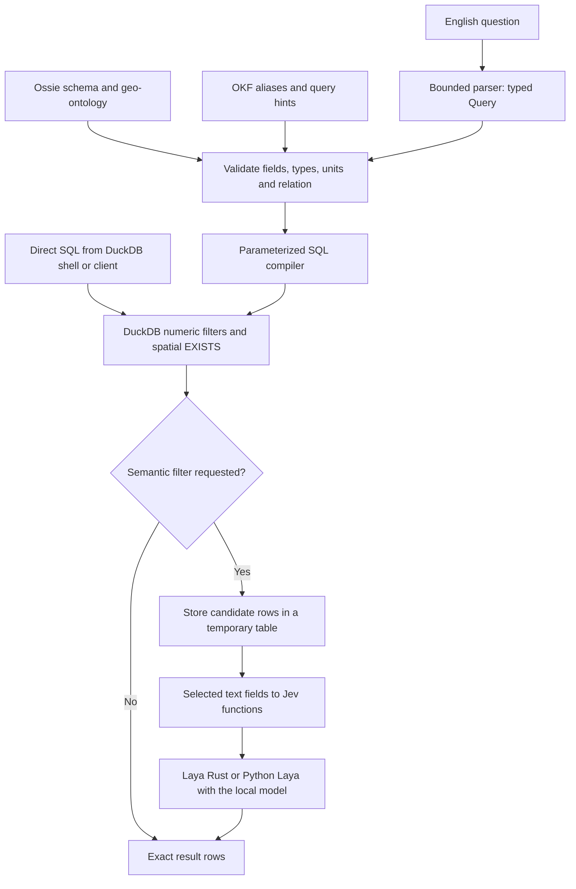

# Design

This document gives the reasons for the project structure.
The [terms](../README.md#terms) in the README apply.

## Components

| Component | Responsibility |
|---|---|
| Ossie, ontology, and OKF | Define fields, aliases, units, spatial relations, and project rules. |
| Typed query and compiler | Validate identifiers and operators. Bind literal values as SQL parameters. |
| DuckDB | Evaluate attribute conditions and spatial relations. |
| Laya | Evaluate explicit text questions with the local model. |
| Native extension | Register Jev functions in DuckDB 1.5.6. Run Laya through a local ONNX Runtime library. |
| tev1 harness | Validate answer choices. Score the local SQL results and model answers. |

## Execution boundary

A model that receives one well row cannot find nearby pipelines in another table.
That query needs the pipeline table, a coordinate reference system (CRS), distance units, and a spatial relation.
WKB geometry as text does not give the model these operations.

Thus the work has two parts.
The compiler or the SQL author defines the query structure.
DuckDB evaluates the exact filters.
Laya evaluates only the requested text conditions.
The compiler does not execute SQL from Laya or from metadata.
The model has no database connection.

[Jev's SQL interface](https://duckdb.org/2026/09/29/jev) gives typed answers inside SQL expressions.
Laya gives similar local answer types.



### Why the example question needs no model

Each condition of the example question maps to a database fact.
DuckDB evaluates `water_depth > 350` and `current_phase = 'IN SERVICE'` directly.
Thus the compiler emits only exact filters. It makes no model evaluations.
A semantic filter is useful for a text condition, for example a question about an inspection note.

### Why candidate rows go to a separate table

`execute()` first runs `CREATE OR REPLACE TEMP TABLE _jev_candidates AS <exact SQL>`.
It then applies the semantic filter to that table in a second statement.
Thus exact filtering completes before the first model evaluation.
The expression `cheap_condition AND jev(...)` does not make that order.
A CTE or a `LIMIT` alone does not control the evaluation order or the budget.
The connection is read-only. Writes change only temporary session data.

## Native extension

### Evaluation of duckdb-jev

The first evaluation used `../duckdb-jev` at `58e548463b0bfb25d86bc68b11515a1daaf87ab3`.
Its C++ extension registers Jev scalar functions.
Its client groups row requests into HTTP requests to TypeSafe.
It has API-key settings, retries, request concurrency, and a cache for each database instance.
Its build uses OpenSSL and DuckDB source submodules.
Its documented DuckDB target is 1.5.5.

| Option | Assessment |
|---|---|
| Adapt the hosted C++ client | Needs a replacement of its central inference path. |
| C++ extension with Rust FFI | Adds a second native-language boundary and a DuckDB source build. |
| Rust extension with Laya Rust | Uses the existing local inference library. Selected. |
| Python UDF backend | Stays available for development and Python applications. |

The native extension keeps the upstream SQL interface and execution pattern.
It replaces hosted inference with local Laya inference.
It does not use the upstream HTTP transport or credentials.
The sibling `duckdb-jev` checkout is not changed.

### Build and packaging

The native extension uses the `duckdb` crate 1.10506.1.
It uses `laya-onnx` from `../laya/laya-rust` with the download feature disabled.
The `ort` crate loads a local ONNX Runtime library through `ORT_DYLIB_PATH`.
The build downloads no runtime binaries.

The Rust bindings use the unstable DuckDB C extension API.
Thus the file declares `C_STRUCT_UNSTABLE` and targets DuckDB 1.5.6 exactly.
This choice agrees with the
[official Rust extension template](https://github.com/duckdb/extension-template-rs/blob/main/Makefile).
[scripts/build_extension.py](../scripts/build_extension.py) writes the metadata footer format of the
[DuckDB extension tools](https://github.com/duckdb/extension-ci-tools/blob/main/scripts/append_extension_metadata.py).

### Cache implementation

The cache stores validated `serde_json::Value` answers.
A cache lookup returns a reference to the stored answer.
Scalar functions read its fields while the runtime lock is held.
Only `jev_eval` serializes the answer to SQL output.
One `HashMap::entry` lookup handles cache hits and insertion.

Options stay in a Rust string vector from SQL input to answer validation.
The runtime serializes the options one time, for the size limit and the cache key.
A cache hit skips the question construction and the second parse of the state.
The SQL input boundary still validates and normalizes JSON input.
[Validation](validation.md#change-history) gives the benchmark results.

## Upstream review

On 2026-10-20, the review read `../recodelabs/duckdb-jev` at commit
`378d36ffba2b7dd8cc3e1a20a673768748892bbe`.
The checkout had no local changes.
The review covered registration, evaluation, cache state, transport, SQL tests, and design notes.
The review read the C++ source only. It did not build or run the upstream extension or its mock server.

The review found one useful pattern: one evaluation path serves several SQL functions.
Thus the native extension added `jev_eval`, `jev_confidence`, and `jev_score_norm`.
These functions add no remote service, dependency, or credential.

### Findings in the upstream source

These findings come from source review. They are not failures observed in an upstream build.

| Priority | Finding | Result |
|---|---|---|
| P1 | The cache key omits the configured model and endpoint. A setting change does not clear the shared cache. | After a model or endpoint change, a cached row and question can return the previous answer. Connections with different settings can also use it. |
| P2 | Question and option boundaries use unescaped control-character delimiters. | Two different option lists can make the same cache key. One list can receive the answer of the other. |
| P2 | Response parsing checks that each answer exists. It does not check the kind, probability bounds, selected label, or distribution. | A malformed successful response can enter the cache. SQL can then return NULL or an invalid value. |

The cache findings come from
[`BuildCacheKey`, the lookup, and the setting changes](https://github.com/recodelabs/duckdb-jev/blob/378d36ffba2b7dd8cc3e1a20a673768748892bbe/src/jev_extension.cpp).
For example, `["a\u001eb", "c"]` and `["a", "b\u001ec"]` make the same joined text for the same question and kind.
The response finding comes from
[`ParseResponse`](https://github.com/recodelabs/duckdb-jev/blob/378d36ffba2b7dd8cc3e1a20a673768748892bbe/src/jev_client.cpp).

The upstream cache compares the full row text when row hashes collide.
It stores colliding rows separately. It records failed batches after the workers finish.
The upstream cache belongs to one database instance. It has no size limit.
The upstream concurrency setting limits workers for each DuckDB thread.
It does not limit the total workers for a query.

### Local differences

| Item | Native extension |
|---|---|
| Cache key | Full JSON tuple of state, question, kind, and ordered options |
| Answer validation | Kind, labels, finite bounds, confidence fields, and complete distributions before the cache |
| Failure count | `errors` counts failures after model evaluation starts, including truncated results |
| Model load | A successful load replaces the model and clears the cache. A failed load keeps both. |
| NULL options | Return NULL |
| Function name conflicts | The new function names use the existing conflict check |

The native extension uses the upstream function names. It does not copy the hosted model behavior.
The pinned Rust registration API uses the default DuckDB NULL handling.
The native extension adds no custom callback layer.

The native extension adds none of these upstream features:

- Hosted request batching.
- HTTP retries.
- Remote endpoint settings.
- Cost estimates.
- An unlimited cache.

The upstream API sends several rows as shared context in one request.
That request format changes the model input. It would need a separate evaluation.

## Laya CPU policy correction

The Laya base commit is `ffc142012af63d015fa19f05f29f9c5ff329a2cc`.
At that commit, the CPU branch returned an unchanged session builder.
The `ort` 2.0.0-rc.13 builder uses the `MaxEfficiency` device policy by default.
On the tested Mac, that policy selected a model compilation path that failed before inference.

The correction sets `AutoDevicePolicy::PreferCPU` explicitly in the CPU branch.
It adds four lines and removes one line in `../laya/laya-rust/src/laya_engine.rs`.
The local `../laya` checkout already has the correction.
The Python backend does not need it.

Note: Apply the patch only to a fresh checkout at the base commit.

1. Apply the saved patch.

   ```sh
   git -C ../laya apply "$PWD/native/laya-cpu-policy.patch"
   ```

## Limits and possible extensions

### English coverage

The planner rejects unknown clauses. It does not send them to a model.
Broader English support can use the typed `Query` API.
That work needs labeled requests and expected plans.
Laya choice answers could select entities, fields, comparators, relation types, and quantifiers from approved ontology values.
Literal values still need extraction from the text and unit parsing.
A choice model cannot supply arbitrary numbers or SQL.
Each selected value must pass deterministic validation.
Ambiguous or unparsed input must cause an error.

A probability threshold alone does not validate a plan.
An evaluation must measure full-plan accuracy on requests that are not training data.
It must also check negation, quantifiers, numeric values, and CRS choices.
The file `ontology/plans.json` contains project examples. This project did not use them as training data.
OR expressions, nested relations, temporal Allen predicates, and derived concepts need query-model and compiler changes.
Each change needs tests.

### Scale

The example query compares 600 deep wells with 63 in-service pipelines.
Larger datasets need query-plan measurements before index changes.
Possible changes include projected temporary geometry tables and spatial joins.
An index on source coordinates possibly does not make a transformed correlated predicate faster.
The project creates no persistent index or projected column in the source database.
